<p align="center">
  
</p>

# Mazda

**Mazda** is an AI browser-automation studio for **UI-driven agents**. Instead of calling backend APIs, an LLM agent drives a real frontend in a real browser — the way a human would.

Hand Mazda your **UI source** — HTML, JavaScript, React, Vue, or any frontend framework — analyze it once, and it produces a structured **Signature** with a **function catalogue** of Playwright operations. At runtime, a plain-English prompt triggers **gather → plan → execute** against your attached Chrome tab via CDP.

---

## Why we built Mazda

Mazda started inside our company. We wanted to bring **AI agents to legacy web applications** — the kind of internal tools that power day-to-day work but were never designed for programmatic access.

The obvious path was **API-driven**: point an agent at the backend and let it call endpoints. That broke down quickly:

- **APIs were poorly documented.** Finding valid request shapes, edge cases, and the right call sequence meant days of archaeology per service.
- **Critical logic lived in the frontend.** Validation rules, multi-step workflows, and state transitions were implemented client-side — not reflected in any API contract.
- **Every agent had to reimplement that logic.** To drive the app correctly via API, we were effectively rewriting the frontend's behavior inside the agent — duplicated effort, fragile, and impossible to keep in sync as the UI changed.

We shifted to a **front-driven approach**: let the agent use the application the way a user does, through the UI. Mazda is the tooling that makes that tractable — heavy LLM work **once at design time** to produce a structured Signature and function catalogue, then cheap, reliable execution at runtime.

**The result:** building an agent for a simple component went from **~50 hours to ~1 hour**.

| Approach | How it works | Where it hurts |
|----------|--------------|----------------|
| **API-driven** | Agent calls backend APIs directly | Undocumented endpoints, client-side logic you must reimplement, poor composability across legacy services |
| **UI-driven (Mazda)** | Agent drives the frontend like a user | Unstable selectors and complex widgets — *unless* you invest in design-time analysis once |

> **Thesis:** A stable, semantic description of the UI — plus pre-built operations over it — is a far better contract for an LLM than the raw DOM *or* an undocumented API surface.

---

## How it works

```
DESIGN-TIME (per component)
    UI source          ─┐
    Manual hints       ─┼─►  LLM analysis  ─►  Signature  ─►  PostgreSQL
                        ┘                      + function catalogue

RUNTIME (per agent request)
    state functions  ─►  gather()  ─►  state snapshot ─┐
                                                       ├─►  LLM  ─►  Plan  ─►  execute
    user prompt  ──────────────────────────────────────┘              (action functions
                                                                       in real browser)
```

**Browser attachment:** Mazda executes against **your** Chrome via [Chrome DevTools Protocol (CDP)](https://chromedevtools.github.io/devtools-protocol/). Start Chrome with remote debugging, attach a tab in the TopBar CDP panel, and runs execute locally.

**External agents:** An [MCP (Model Context Protocol)](https://modelcontextprotocol.io/) server at `/api/mcp` lets external LLM agents invoke Mazda tools.

---

## Tour the UI

Screenshots from a live account. Persian prompts and labels were translated to English for the docs shots (in-browser only — data in the app is unchanged).

### Studio

The landing page after login: create a new Signature, browse the shelf, and see recent runs.

<p align="center">
  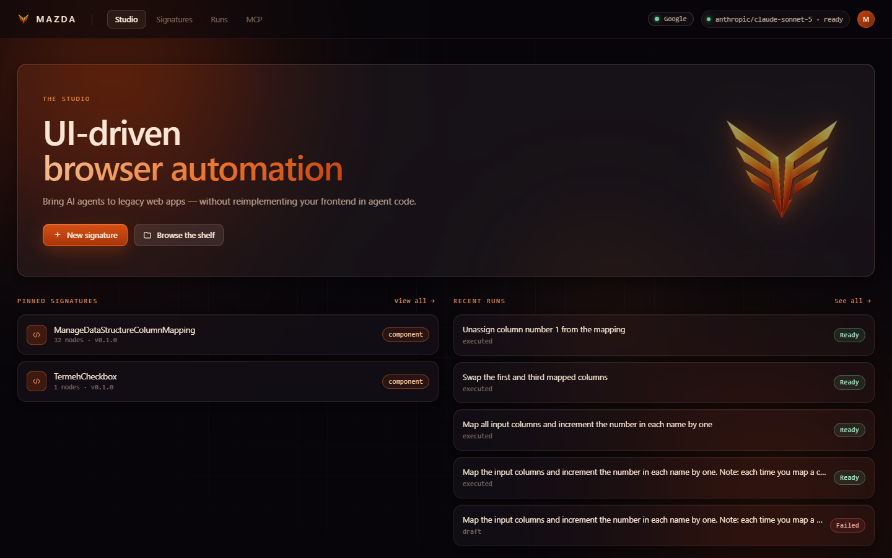
</p>

### Signatures (the shelf)

Every saved Signature lives here. Pick one to edit the wizard or start a run.

<p align="center">
  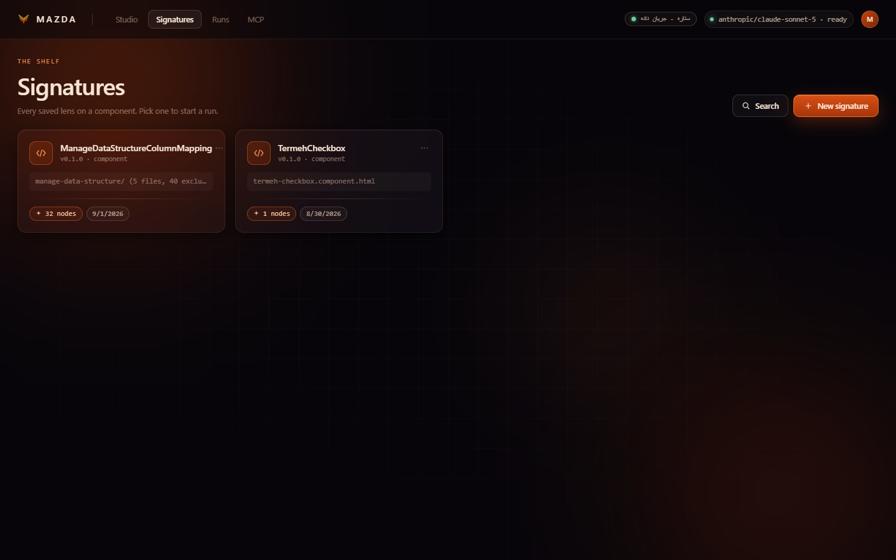
</p>

### Upload (wizard step 1)

Drop UI source — a file or a folder of HTML, JS, templates, or any text-based frontend. Optional name, exclude globs, and a human description go to the analyzer as extra context.

<p align="center">
  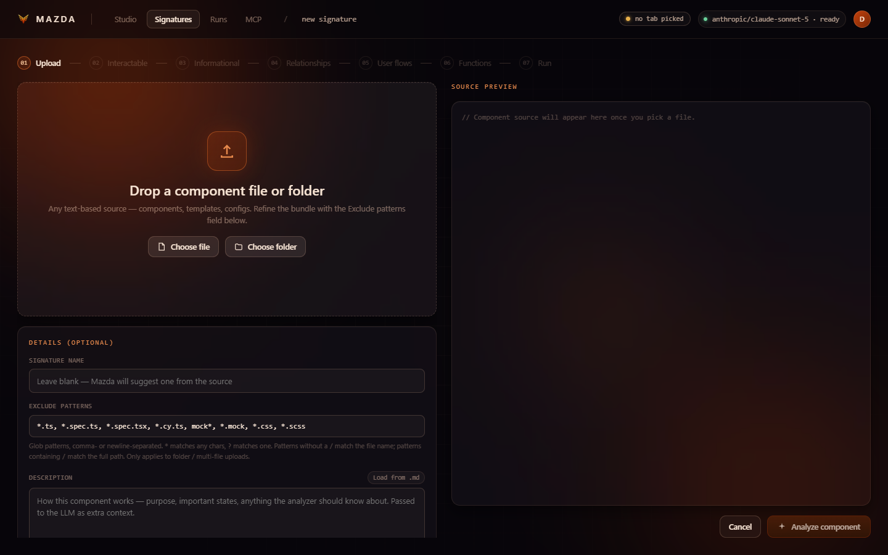
</p>

The rest of the wizard (interactable → informational → relationships → flows → functions → run) is the 7-step pipeline described below.

### Wizard walkthrough: `ManageDataStructureColumnMapping`

A real Signature from the running app — a legacy column-mapping UI (32 elements, dependency on `TermehCheckbox`). Below are the wizard steps after analysis.

#### Interactable (step 2)

22 interactive elements with Playwright selectors, plain-English descriptions, and optional logic notes. Dependencies (here: `TermehCheckbox`) are listed so nested components stay in context.

<p align="center">
  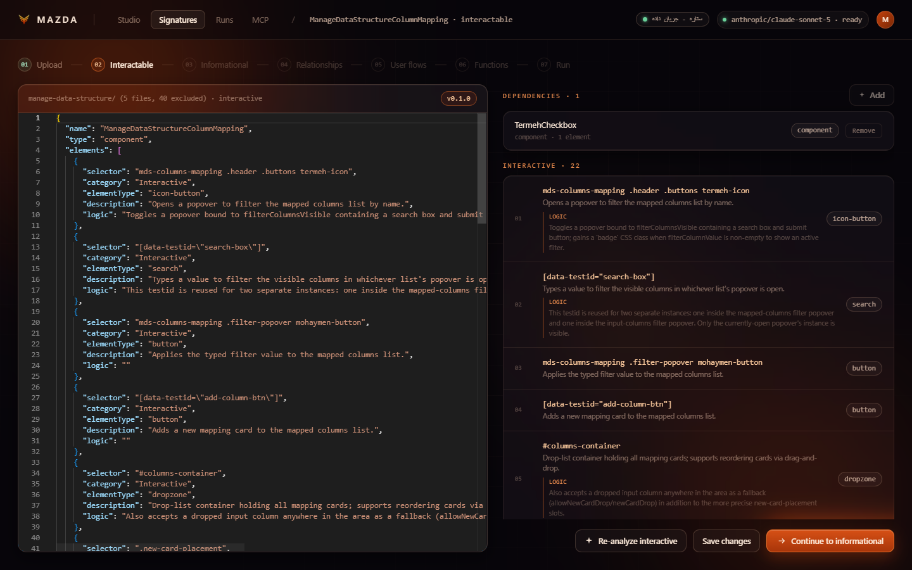
</p>

#### Informational (step 3)

Read targets — headings, status icons, column names — that state functions snapshot during gather.

<p align="center">
  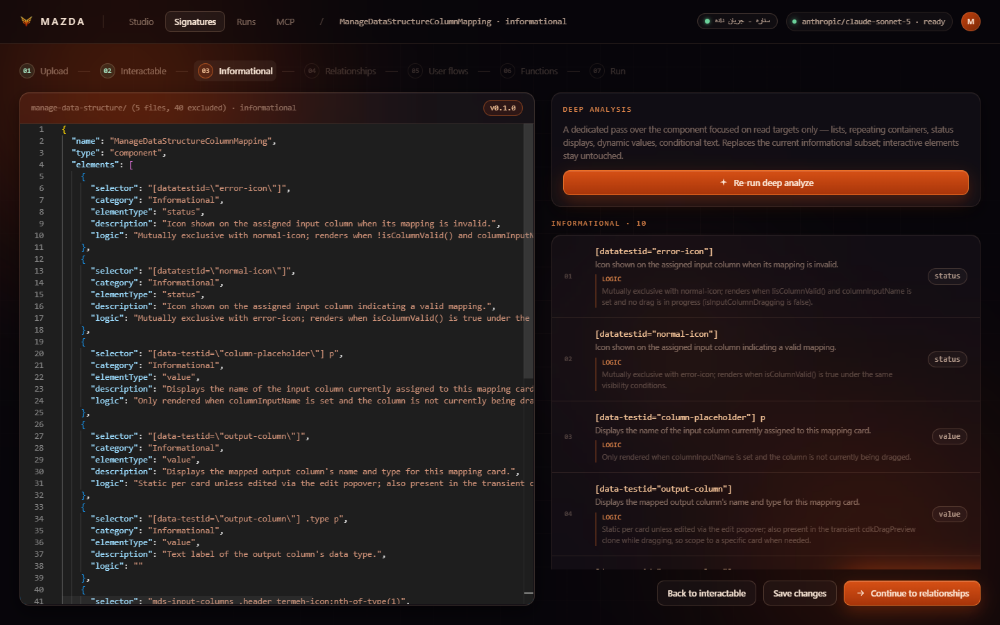
</p>

#### Relationships (step 4)

Semantic graph of how elements relate (labels, controls, grouped-under, …). This Signature has 37 nodes and 49 edges.

<p align="center">
  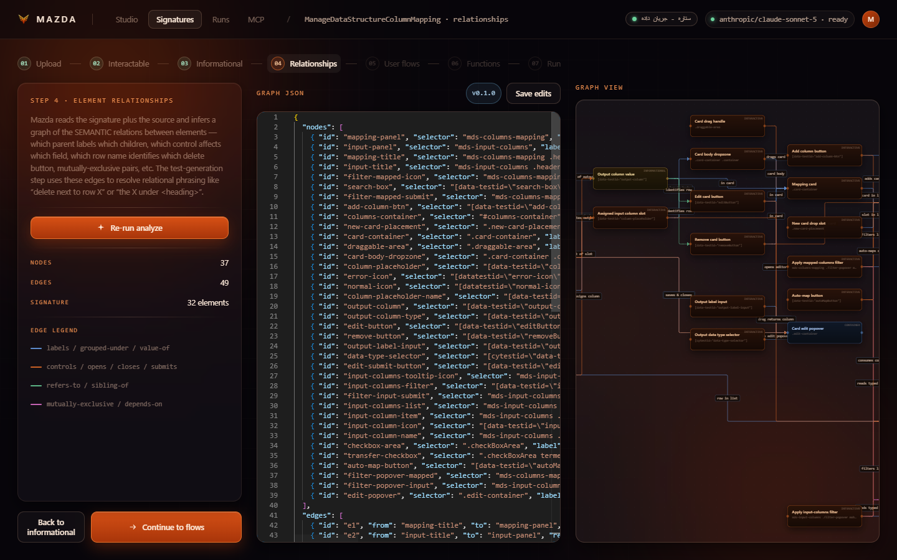
</p>

#### User flows (step 5)

DFA of plausible UI states and transitions (15 states, 27 transitions) — grounding for the function catalogue.

<p align="center">
  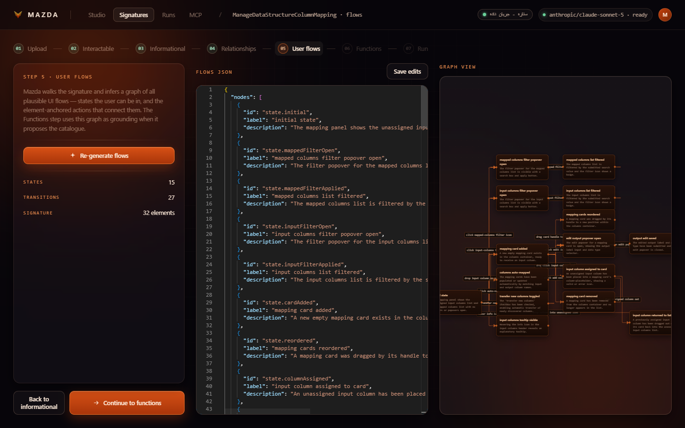
</p>

#### Functions (step 6)

Generated catalogue: **4 state** readers (`GetMappingCards`, `GetInputColumns`, …) and **11 actions** (`AssignInputColumnToCard`, `UnassignInputColumn`, `AutoMapColumns`, …). Each function can be tested live against the attached Chrome tab.

<p align="center">
  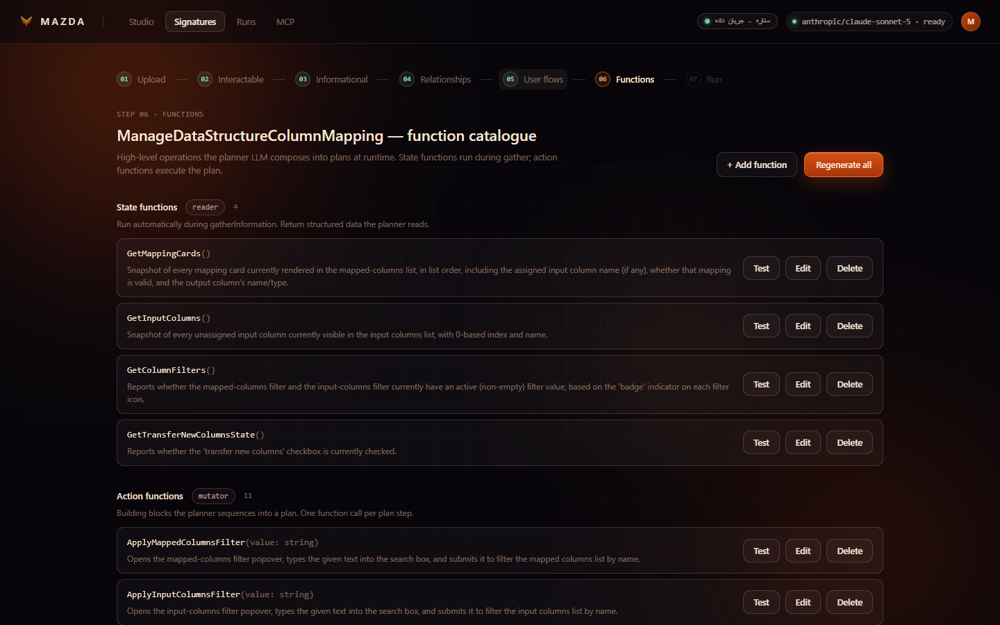
</p>

#### Run (step 7)

Enter a plain-English prompt (Persian or English). Mazda gathers state, plans, and executes.

<p align="center">
  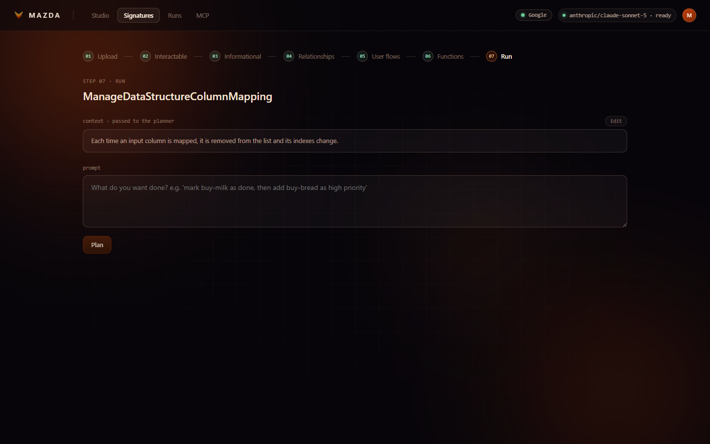
</p>

An executed run shows the gathered state snapshot, the plan (`UnassignInputColumn(cardIndex=2)`), and step results:

<p align="center">
  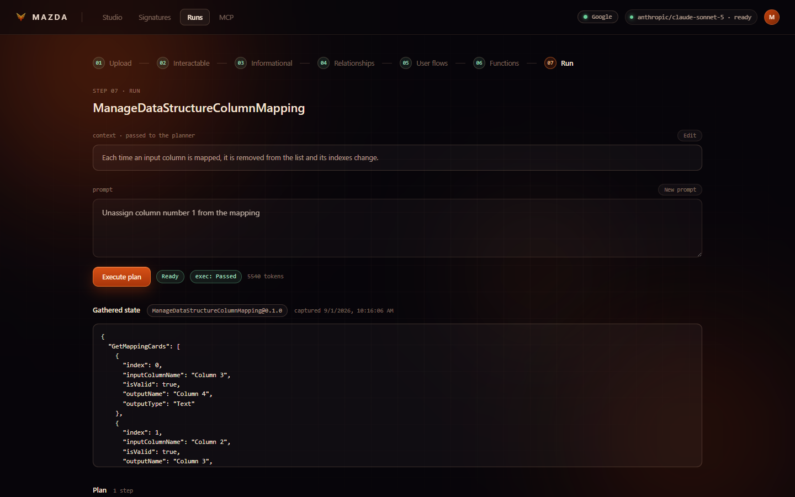
</p>

### Runs

History of gather → plan → execute. Each run stores the prompt, state snapshot, plan, and execution result.

<p align="center">
  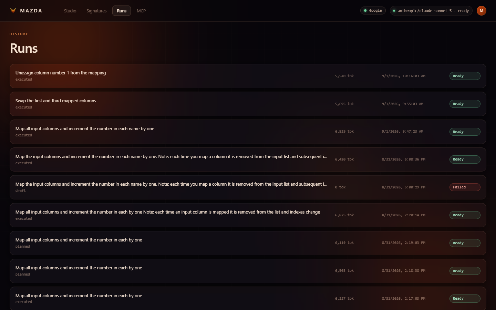
</p>

### MCP server

Expose Signatures as MCP tools. Point a client at `/api/mcp` with your JWT; a tool call runs gather → plan → execute against the attached browser.

<p align="center">
  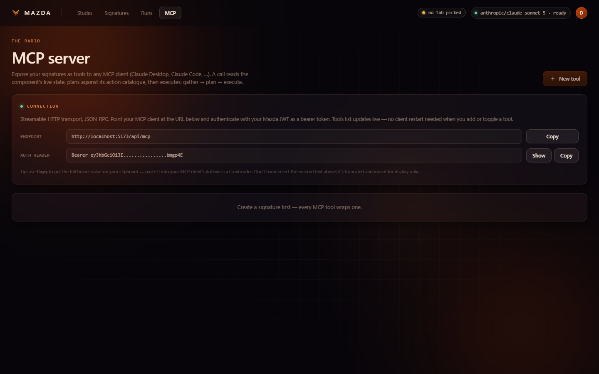
</p>

### Browser attachment (CDP)

TopBar panel: pick the Chrome tab Mazda should drive. Gather, function tests, and execute all hit this tab — not whichever page happens to be first in the CDP list.

<p align="center">
  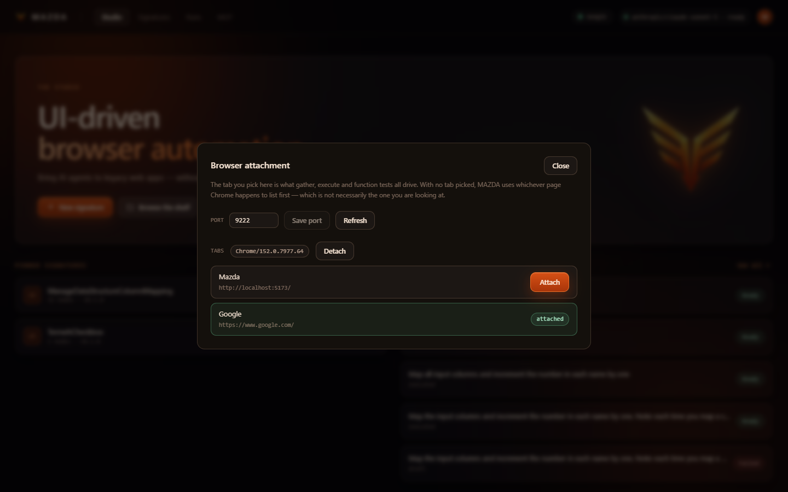
</p>

---

## Example: a to-do list

Suppose you upload a simple to-do UI — an input, an add button, a list of tasks with done / remove / priority controls. Mazda walks the wizard once and produces a **Signature**: elements, relationships, flows, and a **function catalogue**.

### Signature shape

A Signature is Mazda's structured description of one UI surface. After analysis it looks like this (fields match the API DTO):

```json
{
  "id": "…",
  "name": "todo-list",
  "version": "1.2.0",
  "type": "list",
  "humanDescription": "A to-do list: add, complete, remove, and change priority.",
  "elements": [
    {
      "selector": "#task-input",
      "category": "Interactive",
      "elementType": "input",
      "description": "Name of the new task."
    },
    {
      "selector": "#priority-select",
      "category": "Interactive",
      "elementType": "select",
      "description": "Priority for the new task: low, med, or high."
    },
    {
      "selector": "#add-btn",
      "category": "Interactive",
      "elementType": "button",
      "description": "Adds the named task to the list."
    },
    {
      "selector": ".task-row",
      "category": "Informational",
      "elementType": "list-item",
      "description": "One task: name, priority, done checkbox, remove button."
    }
  ],
  "relationshipsJson": "{ \"nodes\": […], \"edges\": [{ \"from\": \"#add-btn\", \"to\": \".task-row\", \"relation\": \"creates\" }] }",
  "userFlowsJson": "{ \"nodes\": […], \"edges\": [{ \"from\": \"idle\", \"to\": \"added\", \"action\": \"AddTask\" }] }",
  "dependencyIds": []
}
```

`elements[].selector` is Playwright-ready CSS. Interactive elements are things the agent can operate; informational elements are read targets for state functions.

### Generated catalogue

```
state:   GetTasks()    → Task[]     // [{ index, name, priority, done }, ...]
         GetFilters()  → { view, sortBy }

action:  AddTask(name, priority)
         RemoveTask(index)
         DoneTask(index)
         ChangePriority(index, priority)
         SetFilter(view)
```

State functions are read-only and run automatically during gather. Action functions are the operations the planner can call — named for user intent (`AddTask`), not DOM clicks (`ClickAddButton`).

A catalogue function is stored as name + kind + JSON Schema + a Playwright body:

```json
{
  "name": "GetTasks",
  "kind": "state",
  "description": "Returns every task currently in the list.",
  "parametersJsonSchema": { "type": "object", "properties": {} },
  "returnsJsonSchema": {
    "type": "array",
    "items": {
      "type": "object",
      "properties": {
        "index": { "type": "integer" },
        "name": { "type": "string" },
        "priority": { "type": "string", "enum": ["low", "med", "high"] },
        "done": { "type": "boolean" }
      }
    }
  }
}
```

```ts
// GetTasks — state. No args; return value is the gather snapshot.
async (page) => {
  return page.$$eval(".task-row", (rows) =>
    rows.map((row, index) => ({
      index,
      name: row.querySelector(".title")?.textContent?.trim() ?? "",
      priority: row.getAttribute("data-priority") ?? "med",
      done: row.querySelector("input[type=checkbox]")?.checked ?? false,
    }))
  );
};
```

```json
{
  "name": "AddTask",
  "kind": "action",
  "description": "Adds a task with the given name and priority.",
  "parametersJsonSchema": {
    "type": "object",
    "required": ["name", "priority"],
    "properties": {
      "name": { "type": "string" },
      "priority": { "type": "string", "enum": ["low", "med", "high"] }
    }
  },
  "returnsJsonSchema": { "type": "null" }
}
```

```ts
// AddTask — action. Args are destructured from the plan step.
async (page, { name, priority }) => {
  await page.fill("#task-input", name);
  await page.selectOption("#priority-select", priority);
  await page.click("#add-btn");
};
```

Bodies run against the attached Chrome tab. The planner never sees the TypeScript — only `name`, `description`, and the schemas.

### Runtime: one prompt

User asks: *"mark buy-milk done and add buy-bread as high priority"*

**1. Gather** — Mazda runs the state functions against the attached browser:

```json
{
  "signature": "todo-list@1.2.0",
  "state": {
    "GetTasks": [
      { "index": 0, "name": "buy milk", "priority": "med", "done": false }
    ],
    "GetFilters": { "view": "all", "sortBy": "created" }
  }
}
```

**2. Plan** — the only runtime LLM call. It picks functions and fills literal args from the snapshot:

```json
{
  "reasoning": "buy milk is index 0 (not done). Mark it, then append the new task.",
  "steps": [
    { "id": "s1", "call": "DoneTask", "args": { "index": 0 } },
    { "id": "s2", "call": "AddTask",  "args": { "name": "buy bread", "priority": "high" } }
  ]
}
```

**3. Execute** — the interpreter runs those Playwright bodies in order. No Playwright is authored at request time; the model never reasons about selectors on the hot path.

---

## Signature wizard (7 steps)

| Step | Route | What happens |
|------|-------|--------------|
| 1. Upload | `/signatures/new` | Paste or upload UI source (HTML, JS, templates, component files); LLM extracts interactive elements |
| 2. Interactable | `/signatures/:id` | Review/edit interactive selectors |
| 3. Informational | `/signatures/:id/informational` | Read-only / status selectors |
| 4. Relationships | `/signatures/:id/relationships` | Semantic element graph |
| 5. User flows | `/signatures/:id/flows` | DFA-shaped flow graph |
| 6. Functions | `/signatures/:id/functions` | Generate & test the function catalogue |
| 7. Run | `/signatures/:sigId/run` | gather → plan → execute against attached browser |

Signatures can **embed other signatures** as dependencies; the effective context merges transitively at generation time.

---

## Quick start

### Prerequisites

- [Docker](https://docs.docker.com/get-docker/) and Docker Compose
- An **OpenAI-compatible** LLM endpoint (OpenAI, Ollama, OpenRouter, Groq, DeepSeek, vLLM, etc.)
- **Google Chrome** with remote debugging enabled (for runs)

### 1. Configure environment

```bash
git clone <your-repo-url>
cd mazda-app
cp .env.example .env
```

Edit `.env`:

```env
JWT_SECRET=change-me-this-must-be-at-least-32-chars-long
LLM_BASE_URL=https://api.openai.com/v1
LLM_API_KEY=sk-...
LLM_ANALYZER_MODEL=gpt-4o-mini
LLM_GENERATOR_MODEL=gpt-4o
LLM_TIMEOUT_SECONDS=600
```

### 2. Start the stack

```bash
docker compose --env-file .env up --build
```

| Service | URL |
|---------|-----|
| Frontend | http://localhost:5173 |
| API + Swagger | http://localhost:5080/swagger |
| PostgreSQL | `localhost:5434` (user/pass/db: `mazda`) |

The API auto-creates the database schema on first boot.

### 3. Attach Chrome (required for runs)

Start Chrome with remote debugging:

```bash
# Windows
"C:\Program Files\Google\Chrome\Application\chrome.exe" --remote-debugging-port=9222 --remote-debugging-address=0.0.0.0

# macOS
/Applications/Google\ Chrome.app/Contents/MacOS/Google\ Chrome --remote-debugging-port=9222 --remote-debugging-address=0.0.0.0

# Linux
google-chrome --remote-debugging-port=9222 --remote-debugging-address=0.0.0.0
```

In the Mazda UI TopBar, open the **CDP panel**, verify the browser is reachable, and **attach** to the tab you want to automate.

### 4. Create your first Signature

1. Register / sign in at http://localhost:5173
2. **New Signature** → paste or upload UI source (HTML, JS, or any frontend files) → run analysis
3. Walk through the wizard steps (interactable → informational → relationships → flows → functions)
4. Test individual functions in the Functions step against your attached tab
5. **Run** with a plain-English prompt (e.g. *"Add a task called 'Buy milk' with high priority"*)

---

## LLM provider configuration

Mazda speaks the **OpenAI Chat Completions API**. Set four env vars to point at any compatible endpoint:

| Provider | `LLM_BASE_URL` | Notes |
|----------|----------------|-------|
| OpenAI | `https://api.openai.com/v1` | Default. `gpt-4o-mini` + `gpt-4o` recommended |
| Ollama | `http://host.docker.internal:11434/v1` | `LLM_API_KEY=ollama` (any non-empty string) |
| OpenRouter | `https://openrouter.ai/api/v1` | Models namespaced, e.g. `openai/gpt-4o` |
| DeepSeek | `https://api.deepseek.com/v1` | `deepseek-chat`, `deepseek-coder` |
| Groq | `https://api.groq.com/openai/v1` | Fast inference; Llama family |
| Together | `https://api.together.xyz/v1` | Open-weight models |
| vLLM / LM Studio | `http://host.docker.internal:8000/v1` | Use your served model name |

**Docker note:** Local LLM servers are reached from the API container at `host.docker.internal`. On Linux, `extra_hosts: ["host.docker.internal:host-gateway"]` is already configured in `docker-compose.yml`.

**Compatibility notes:**
- The analyzer uses `response_format=json_object`. OpenAI, OpenRouter, DeepSeek, Groq, and Together support this; older Ollama builds may not.
- Model quality matters: the analyzer reads frontend source (HTML, JS, JSX, templates); the planner/generator need reliable structured output. Local 7–8B models work for analysis but may produce weaker plans.

---

## Development

### Frontend only (hot reload)

With the API running in Docker:

```bash
cd frontend
npm install
npm run dev    # http://localhost:5173 — proxies /api → localhost:5080
```

### Rebuild after backend changes

```bash
docker compose --env-file .env up --build api
```

### Rebuild after frontend changes (production container)

```bash
docker compose --env-file .env up --build web
```

---

## API reference

All authenticated routes require `Authorization: Bearer <jwt>`. Full routing: [`backend/src/Mazda.Api/Endpoints/Endpoints.cs`](backend/src/Mazda.Api/Endpoints/Endpoints.cs).

### Meta

| Method | Path | Auth | Purpose |
|--------|------|:----:|---------|
| GET | `/health` | – | Health check |
| GET | `/api/meta` | – | App metadata |

### Auth

| Method | Path | Purpose |
|--------|------|---------|
| POST | `/api/auth/register` | Create account |
| POST | `/api/auth/login` | Sign in, receive JWT |

### Signatures

| Method | Path | Purpose |
|--------|------|---------|
| GET | `/api/signatures/` | List signatures |
| POST | `/api/signatures/` | Create signature |
| GET | `/api/signatures/{id}` | Get signature |
| PUT | `/api/signatures/{id}` | Update signature |
| DELETE | `/api/signatures/{id}` | Delete signature |
| PUT | `/api/signatures/{id}/description` | Update human description |
| POST | `/api/signatures/analyze` | LLM extract from component source |
| POST | `/api/signatures/{id}/reanalyze-interactive` | Re-run interactive analysis |
| POST | `/api/signatures/{id}/analyze-informational` | Informational element pass |
| POST | `/api/signatures/{id}/analyze-relationships` | Generate relationship graph |
| PUT | `/api/signatures/{id}/relationships` | Save relationship graph |
| POST | `/api/signatures/{id}/flows/generate` | Generate user flows |
| PUT | `/api/signatures/{id}/flows` | Save user flows |
| GET/POST/DELETE | `/api/signatures/{id}/dependencies[...]` | Manage signature dependencies |
| GET | `/api/signatures/{id}/functions` | List function catalogue |
| POST | `/api/signatures/{id}/functions/generate` | LLM generate catalogue |
| POST/PUT/DELETE | `/api/signatures/{id}/functions[...]` | CRUD functions |
| POST | `/api/signatures/{id}/functions/{fid}/test` | Test function against browser |
| POST | `/api/signatures/{id}/functions/{fid}/fix` | AI-propose body fix |

### Generations (runs)

| Method | Path | Purpose |
|--------|------|---------|
| GET | `/api/generations/recent` | List recent runs |
| GET | `/api/generations/{id}` | Get run (state, plan, result) |
| POST | `/api/generations/plan` | Create run: gather state + LLM plan (sync) |
| POST | `/api/generations/{id}/execute` | Execute plan (async) |
| GET | `/api/generations/{id}/execution/stream` | SSE live step events |

### CDP (browser attachment)

| Method | Path | Purpose |
|--------|------|---------|
| GET | `/api/cdp/status` | Probe browser, list tabs |
| POST | `/api/cdp/attach` | Attach to tab by `targetId` |
| POST | `/api/cdp/detach` | Detach |
| PUT | `/api/cdp/port` | Set CDP port |

### MCP

| Method | Path | Purpose |
|--------|------|---------|
| GET/POST | `/api/mcp` | Streamable HTTP + legacy SSE transport |
| POST | `/api/mcp/messages` | Legacy SSE message channel |
| GET/POST/PUT/DELETE | `/api/mcp-tools[...]` | CRUD exposed MCP tools |

---

## Tech stack

| Layer | Technologies |
|-------|-------------|
| Frontend | React 18, TypeScript, Vite 5, React Router 6, TanStack Query, Zustand, Monaco Editor, React Flow |
| Backend | ASP.NET Core 8, Minimal APIs, MediatR, FluentValidation, JWT Bearer |
| Database | PostgreSQL 16, EF Core 8 |
| LLM | OpenAI SDK (any OpenAI-compatible endpoint) |
| Browser | Playwright, CDP attach |
| Protocol | MCP (Model Context Protocol) |
| Deploy | Docker Compose (api + web + db), nginx SPA |

---

## How Mazda compares

Mazda sits in a different architectural bucket from most "AI browser agent" tools. The table below compares the main alternatives by **when** LLM work happens and **what** gets reused across runs.

### Comparison table

| Tool | Type | When LLM runs | What gets cached / reused | Best for | Weak at |
|------|------|---------------|---------------------------|----------|---------|
| **[Mazda](MAZDA.md)** | Design-time analyser + runtime planner | Heavy once per UI component (wizard); light LLM call per agent request (plan only) | **Function catalogue** — pre-authored Playwright ops + semantic Signature stored in DB | Legacy internal web apps you control; repeatable agent tasks on known components; **50h → 1h** agent dev | One-off exploration of arbitrary sites; apps you can't inspect source for; fully dynamic third-party UIs |
| **[Stagehand](https://docs.stagehand.dev/)** | Playwright + `act()` / `observe()` / `extract()` | LLM on every uncached action | **[Server-side cache](https://docs.stagehand.dev/v3/best-practices/caching)** (Browserbase): instruction + page content → action replay; **[local `cacheDir`](https://docs.stagehand.dev/v3/best-practices/caching)** for filesystem persistence | General-purpose web automation; self-healing when layout shifts slightly; quick scripts without upfront analysis | Deep frontend logic you must encode in agent code; multi-component internal apps where you want a stable API-like contract |
| **[browser-use](https://github.com/browser-use/browser-use)** | Autonomous agent loop (Python) | LLM **every step** (observe → reason → act) | Optional custom tooling; no built-in semantic catalogue | Open-ended tasks ("find cheapest flight"); research/scraping; embed in Python products | Predictable production workflows on legacy apps; cost/latency at scale; reproducing exact business logic |
| **[Skyvern](https://github.com/Skyvern-AI/skyvern)** | Vision + LLM agent (APA) | LLM **every step**; reads page visually at runtime | Workflow definitions; no design-time source analysis | Third-party portals with no API, MFA/SSO, layout changes | Apps where you have source access and want deterministic ops; non-web desktop (SAP GUI, etc.) |
| **[LaVague](https://github.com/lavague-ai/LaVague)** | World Model + Action Engine | LLM per instruction; generates Playwright/Selenium **at runtime** | Test runner / token tracking; no action cache | QA automation from Gherkin; experimentation | Production agent contracts; legacy apps with complex client-side state machines |
| **[Playwright MCP](https://github.com/microsoft/playwright-mcp)** | Low-level MCP browser tools | LLM decides tool calls each turn; no caching layer | None — raw accessibility-tree snapshots | Coding agents (Cursor, Claude) exploring any page ad hoc | Stable high-level ops for a known component; reducing token burn on repeat tasks |
| **[Anthropic Browser Use](https://platform.claude.com/docs/en/agents-and-tools/tool-use/browser-use-tool)** | Client toolset (27 browser primitives) | LLM every turn in your agent loop | None built-in — you implement executor + session | Claude-native agents with structured a11y tree + screenshots | Pre-built semantic catalogue; legacy app onboarding at scale |
| **Traditional RPA** (UiPath, etc.) | Record & replay selectors | No LLM (unless added) | Recorded scripts | Stable internal ERP with dedicated RPA team | Poorly documented APIs + frontend logic; layout changes break selectors |

### Mazda vs Stagehand caching — the key difference

Both tools reduce LLM cost on repeat work, but they cache **different layers**:

```
Stagehand (runtime action cache)
    "click the Sign in button" + current page snapshot
        → LLM (on MISS) → cached Playwright action
        → replay on HIT (no tokens)

Mazda (design-time catalogue)
    UI source analyzed once
        → Signature + GetTasks(), AddTask(name), …
        → runtime: gather(state) + plan(function names + args)
        → execute pre-validated Playwright bodies (no Playwright generation at runtime)
```

| Dimension | Stagehand cache | Mazda function catalogue |
|-----------|-----------------|--------------------------|
| **Cache key** | Natural-language instruction + live page content ([docs](https://docs.stagehand.dev/v3/best-practices/caching)) | Component identity + curated function schemas |
| **What's stored** | Resolved low-level action (selector, method, args) | High-level **State** + **Action** functions with JSON Schema |
| **LLM on repeat run** | Zero on cache HIT; full inference on MISS | Planner only (~pick `AddTask` + args); never writes Playwright |
| **Invalidation** | Page structure/content change → cache MISS → re-infer | Element/selector change → `InvalidateDerivedCaches()` → re-run wizard |
| **Abstraction level** | Still DOM/instruction-oriented (`act("click Sign in")`) | Semantic/app-oriented (`AddTask(name, priority)`) |
| **Variables** | `%email%` placeholders share one cache entry across values ([docs](https://docs.stagehand.dev/v3/best-practices/caching)) | Function parameters with JSON Schema validation |
| **Setup cost** | Low — point at URL and go | Higher — 7-step wizard per component |
| **Payoff** | Faster/cheaper **repeat identical actions** on similar pages | Faster/cheaper **repeat business operations** on known components forever |

**Analogy:** Stagehand caching is like memoizing SQL query plans. Mazda's catalogue is like defining stored procedures upfront.

### Mazda — pros and cons

**Pros**
- **Amortised LLM cost:** Playwright authoring happens once per component, not per agent request ([FUNCTION_CATALOGUE.md](FUNCTION_CATALOGUE.md))
- **Stable agent contract:** Agents call `AddTask(name)` not `"click the third button in the modal"` — schema-validated before browser touch
- **Legacy-app fit:** Built for poorly documented APIs + frontend-held logic (the 50h → 1h origin story)
- **Framework-agnostic:** Works with HTML/JS, React, Vue, or any text-based UI source
- **Inspectable & editable:** 7-step wizard, live function testing, AI-assisted fix, hand-edited bodies
- **MCP integration:** Expose curated tools to external agents via `/api/mcp`
- **Self-hosted:** Docker Compose, your LLM, your Chrome via CDP — no vendor browser lock-in

**Cons**
- **Upfront investment:** Each component needs the wizard pipeline before runtime pays off
- **Source access helps:** Analyser works best when you can upload/paste UI source; arbitrary black-box sites are harder
- **UI change maintenance:** Selector/body updates require re-analysis or manual edits (like any selector-based approach, but with clearer invalidation)
- **No runtime vision fallback:** Relies on DOM/selectors + state functions, not computer-vision re-read of the page (unlike Skyvern)
- **Browser-only:** Web tab via CDP — no native desktop apps (SAP GUI, Citrix, etc.)
- **No built-in action cache:** Unlike [Stagehand's Browserbase/local cache](https://docs.stagehand.dev/v3/best-practices/caching), Mazda doesn't memoize raw `act()` results — the catalogue *is* the cache, but it must be built first

### When to pick Mazda vs alternatives

| Your situation | Pick |
|----------------|------|
| Internal legacy web app, you have (or can get) UI source, same operations repeated by agents | **Mazda** |
| Quick one-off automation on a site you've never seen; no source access | **Stagehand**, **browser-use**, or **Skyvern** |
| Claude/Cursor agent exploring pages during development | **Playwright MCP** |
| Third-party portal with MFA, frequent layout changes, no source | **Skyvern** |
| Already invested in RPA team + stable SAP/Oracle selectors | **UiPath** / traditional RPA |
| Python product embedding a general web agent | **browser-use** |

---

## Documentation

| Document | Contents |
|----------|----------|
| [MAZDA.md](MAZDA.md) | Full architecture, runtime pipeline, CDP stack, MCP server, persistence, ops, glossary |
| [FUNCTION_CATALOGUE.md](FUNCTION_CATALOGUE.md) | Function catalogue design, live testing, browser attachment, AI fix |

---

## Project structure

```
mazda-app/
├── backend/
│   └── src/
│       ├── Mazda.Domain/          # Entities
│       ├── Mazda.Application/     # Use cases
│       ├── Mazda.Infrastructure/  # EF Core, LLM, Playwright, CDP
│       └── Mazda.Api/             # HTTP endpoints, MCP
├── frontend/
│   └── src/
│       ├── app/                   # Router, auth guard
│       ├── shared/                # API client, components, tokens
│       └── features/              # auth, studio, signatures, generation, cdp, mcp
├── docker-compose.yml
├── .env.example
├── MAZDA.md
└── FUNCTION_CATALOGUE.md
```

---

## License

Apache License 2.0. See [LICENSE](LICENSE) for details.
